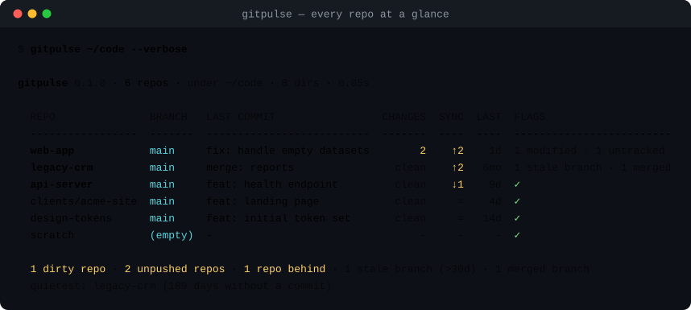

# gitpulse

**Every repository you own, on one screen: what is dirty, what is unpushed, what has gone stale.**

[](https://www.python.org)
[](pyproject.toml)
[](#how-it-works)
[](LICENSE)



You know the feeling: thirty projects, three of them have uncommitted work you
forgot about, one has commits you never pushed, and a branch called
`experiment/rewrite` has been sitting there since spring.

`gitpulse` walks a directory, finds every git repository inside it, and prints a
single table you can read in two seconds:

```console
$ gitpulse ~/code
gitpulse 0.1.0 · 6 repos · under ~/code · 8 dirs · 0.05s

  REPO               BRANCH   LAST COMMIT                 CHANGES  SYNC  LAST  FLAGS
  -----------------  -------  --------------------------  -------  ----  ----  -------------------------
  web-app            main     fix: handle empty datasets        2    ↑2    1d  1 modified · 1 untracked
  legacy-crm         main     merge: reports                clean    ↑2   6mo  1 stale branch · 1 merged
  api-server         main     feat: health endpoint         clean    ↓1    9d  ✓
  clients/acme-site  main     feat: landing page            clean     =    4d  ✓
  design-tokens      main     feat: initial token set       clean     =   14d  ✓
  scratch            (empty)  -                                 -     -     -  ✓

  1 dirty repo · 2 unpushed repos · 1 repo behind · 1 stale branch (>30d) · 1 merged branch
  quietest: legacy-crm (189 days without a commit)
```

No network, no daemon, no config file, no database. Just `git` and a table.

## Why not just `git status`?

`git status` answers "what is the state of *this* repository". `gitpulse`
answers "**which of my repositories needs me today**" — which is the question
you actually have when you sit down to work across many projects.

It is also the question you do not want to answer by `cd`-ing into thirty
directories.

## Install

```console
$ pipx install gitpulse      # recommended: isolated, always on PATH
$ uv tool install gitpulse   # or with uv
$ pip install gitpulse       # or into the current environment
```

From a checkout:

```console
$ git clone https://github.com/OWNER/gitpulse.git
$ cd gitpulse
$ pipx install .
```

Python 3.11+ on Linux and macOS; Windows should work but is untested. Requires
`git` on `PATH`.

## Usage

```
gitpulse [PATH ...] [options]
```

| Option | What it does |
| --- | --- |
| `--only FILTER` | Show only `attention`, `dirty`, `unpushed`, `behind`, `stale` or `detached` |
| `--sort ORDER` | `attention` (default), `activity`, `name`, `changes` |
| `--stale AGE` | A branch counts as stale after `AGE` without commits (`30d`, `12h`, `2w`) |
| `--depth N` | How deep to look for repositories (default `4`) |
| `--jobs N` | Repositories inspected in parallel (default `8`) |
| `--exclude NAME` | Skip directories with this name (repeatable) |
| `-v`, `--verbose` | Add the last commit subject column |
| `--json` | Machine readable output, for cron jobs and dashboards |
| `--fail-on COND` | Exit `1` when something matches: `attention`, `dirty`, `unpushed`, `stale` |
| `--color {auto,always,never}` | Colour control; also honours `NO_COLOR` / `FORCE_COLOR` |
| `--version` | Print the version |

Exit codes: `0` nothing to report, `1` `--fail-on` matched or no root could be
scanned, `2` invalid usage.

### The columns

| Column | Meaning |
| --- | --- |
| `REPO` | Path relative to the scanned root — `clients/acme-site` is unambiguous about which `site` it means |
| `BRANCH` | Current branch, `(detached)` or `(empty)` for a repository with no commits |
| `LAST COMMIT` | The subject line, only with `-v` |
| `CHANGES` | `clean`, or the number of staged + modified + untracked files |
| `SYNC` | `↑n` commits to push, `↓n` to pull, `=` in sync, `no up` without an upstream |
| `LAST` | How long ago the newest commit was made |
| `FLAGS` | Staged/modified/untracked breakdown, stale and merged branches, `no upstream` |

Rows are ordered by *how much they want your attention*: errors, dirty trees,
unpushed work, repositories behind their remote, stale branches, then everything
else by recency.

## Recipes

```console
# morning coffee: what needs me?
gitpulse ~/code --only attention

# which projects have quietly died?
gitpulse ~/code --sort activity --only attention

# spring cleaning: unmerged branches nobody touched in a quarter
gitpulse ~/code --stale 90d --only stale

# find a repository by name in a deep tree
gitpulse ~ --depth 6 --sort name -v | grep -i "invoice"

# dashboards and cron jobs
gitpulse ~/code --json | jq '.totals'

# gate a "you left something behind" check in CI
gitpulse . --fail-on dirty
```

A shell alias pays for itself immediately:

```bash
alias gp='gitpulse ~/code --only attention'
```

## JSON

```console
$ gitpulse ~/code --json | jq '.totals'
{
  "repos": 6,
  "dirty": 1,
  "unpushed": 2,
  "behind": 1,
  "stale_branches": 1,
  "merged_branches": 1,
  "needs_attention": 3
}
```

Every repository object carries `name`, `label`, `path`, `branch`, `detached`,
`empty`, `staged`, `modified`, `untracked`, `changes`, `dirty`, `ahead`,
`behind`, `has_upstream`, `commits`, `last_commit_at`, `last_message`,
`age_seconds`, `stale_branches`, `merged_branches`, `local_branches`, `flags`,
`needs_attention` and `error`.

## How it works

- **Read-only.** `gitpulse` only runs `rev-parse`, `status`, `rev-list`,
  `log` and `for-each-ref`. It never commits, stages, fetches, checks out or
  writes anything. (`GIT_OPTIONAL_LOCKS=0` is set so even the index is left
  alone.)
- **Offline by design.** Ahead/behind are computed against your local refs, as
  of your last `git fetch`. Running `git fetch` in a loop is a network operation
  with side effects; a dashboard should not do that behind your back.
- **Parallel but gentle.** Repositories are inspected in a thread pool
  (`--jobs`), because the work is waiting on subprocesses, not on CPU.
- **Bounded search.** The walk stops at a repository (nested test repositories
  do not explode the table), skips `node_modules`, `.venv`, `dist`, `target` and
  friends, and respects `--depth`.
- **Honest about breakage.** A corrupt repository becomes one row with an
  `error` flag instead of an exception that kills the whole table.

## Development

```console
$ make install     # editable install plus dev extras
$ make test        # pytest
$ make lint        # ruff check + ruff format --check
$ make demo        # regenerate docs/demo*.svg from real repositories
```

The tests build **real git repositories** in temporary directories — no mocked
git, no fixtures checked in — so the suite exercises the same commands you do.

Layout:

```
src/gitpulse/
  git.py       thin, read-only subprocess wrapper
  repos.py     discovery, per-repository inspection, parallel scan
  model.py     immutable RepoState snapshot + derived flags
  report.py    ordering, filters, table, summary, JSON
  ui.py        colour, column alignment, small formatters
tests/         real repositories in tmp_path, no network
```

See [CONTRIBUTING.md](CONTRIBUTING.md) if you want to add a column or a check.

## Roadmap

- `--fetch` (opt-in) to refresh ahead/behind before reporting
- submodule and worktree awareness beyond "it is a repository"
- a `--watch` mode that redraws the table every few seconds
- PR/issue counts per repository, when `gh` is available

## FAQ

**Does it phone home?**
No. There is no network code in the package at all.

**Does it modify my repositories?**
No. It does not write, stage, commit, fetch or check out anything.

**Does it follow submodules?**
A submodule appears as a directory inside a repository; `gitpulse` reports the
parent and does not descend into it. Worktrees (`git worktree add`) are found as
regular repositories.

**Why are `ahead`/`behind` out of date?**
Because they describe your *local* view. `git fetch` first (or wait for the
planned `--fetch` flag).

**Linux, macOS, Windows?**
Linux and macOS are tested. Windows should work — the wrapper only calls `git`
— but the suite is not run there yet.

## License

MIT — see [LICENSE](LICENSE).

---

<sub>Türkçe doküman: [README.tr.md](README.tr.md)</sub>
